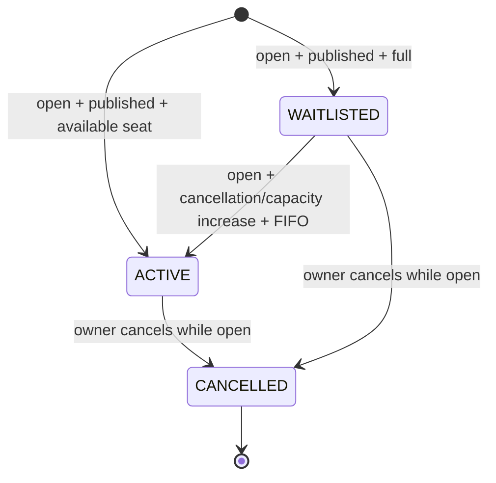

# Proposed architecture and bottom-up design

M3 technical candidate: integrated student/admin SPA, business APIs, course-level guards, separate-process CON/recovery and measured SCL are implemented. See milestones/M3.md. The simulator lives at tools/directory-simulator.js, browser tests at client/tests, and runtime storage defaults to LOCALAPPDATA/Electiva/dev.sqlite. Genuine member reviews and teacher acceptance remain separate gates. Original planning alternatives below remain historical context where explicitly proposed.

## Shape and technology

Use one repository with npm workspaces: `server/` (Express REST, JavaScript ESM, Sequelize), `client/` (React/Vite SPA), `tools/` (seeding/load/results), `services/course-directory-simulator/` (separate local HTTP integration), `tests/e2e/`, `docs/`, `artifacts/` (small reports/manifest, not databases). Prefer a modular monolith with routes → authorization/validation → business services → repositories/models → SQLite. Native fetch is the HTTP client. A simple CSS design system is sufficient. Additional test/session/password libraries need short justification and locked versions.

Production Express serves built SPA assets and `/api/v1`; unknown API paths return JSON 404, SPA navigation uses the HTML fallback. Development Vite proxies `/api` to loopback Express. UI permissions improve usability; only server authorization establishes access.

SQLite database/WAL files belong outside this OneDrive checkout, for example `%LOCALAPPDATA%/JIN/course-enrollment/dev.sqlite`. Test runs get independent temporary local disk files. WAL is not a network-filesystem design; do not put a running SQLite database in a synced/shared folder. Use one Express process for the measured initial deployment, plus independent-connection tests to prove the database boundary. Scaling claims are limited to that topology.

## Data model and migration order

1. **users**: id, normalized unique email, displayName, passwordHash, role CHECK(student/admin), createdAt. No real class/student records; seeded users are synthetic.
2. **sessions**: hashed session-token identifier, userId FK, expiresAt, createdAt. Server-controlled role; rotate on login; logout revokes. No bearer token in localStorage.
3. **courses**: id, unique code, title, description, department, credits positive, externalCode nullable; archive rather than deleting referenced courses.
4. **offerings**: id, courseId FK, term, capacity integer >=0, opensAt/closesAt UTC epoch milliseconds with opensAt<closesAt, lifecycle CHECK(DRAFT/PUBLISHED/ARCHIVED), version for conditional admin updates. Offerings represent a course in a term; enrollment uniqueness is per offering.
5. **enrollments**: increasing integer id, offeringId/userId FKs, status CHECK(ACTIVE/WAITLISTED/CANCELLED), createdAt/updatedAt/cancelledAt. Each new enrollment attempt gets a new id; cancelled history is retained. Partial UNIQUE(userId,offeringId) WHERE status IN ('ACTIVE','WAITLISTED') prevents duplicate current memberships. ACTIVE is the seat-consuming state. FIFO uses monotonically increasing enrollment id, so cancellation and re-enrollment joins the end fairly.

Integrity migrations add FK enforcement, status/time/capacity CHECKs, the partial unique index, and indexed ACTIVE lookup. BEFORE INSERT/UPDATE triggers reject entering ACTIVE if the current active count is already capacity; another trigger rejects capacity below existing active count. Do not treat an in-memory count or UI button as the invariant. Forbid changing userId/offeringId of an existing enrollment; use explicit lifecycle services. Test raw-SQL bypasses of ORM validation, rollback behavior and both INSERT/UPDATE paths. Check migration SQL against the selected SQLite driver before acceptance.

Keep required integrity indexes in both performance variants. SCL cannot remove a safety constraint to obtain a faster benchmark.

## Enrollment state machine

A subsequent request after cancellation creates a new attempt; never resurrect a cancelled historical row. Repeating an enrollment request while already ACTIVE/WAITLISTED returns the existing record; repeating cancellation while still open returns its existing CANCELLED representation. Deny all student mutations outside [opensAt,closesAt). The server reads its clock after acquiring the write transaction; all statements use that captured time consistently. Test exact endpoints, UTC conversions, and an open→closed race. Offering archive is blocked while current memberships remain, unless a later teacher rule defines cancellation of the entire offering.

## CON transaction algorithm

1. Authenticate; obtain student identity from the session. Validate offering/request. Start a managed Sequelize `IMMEDIATE` write transaction on a real file DB, and explicitly pass the transaction to every query. Enable foreign keys and configure busy timeout for every connection; M1 supports a zero driver wait plus bounded asynchronous acquisition retry to avoid worker-thread starvation. Use WAL only after a version/driver compatibility check.
2. Inside the transaction reread offering lifecycle, server-time window and existing current membership. Reject closed/unpublished offering. Return the existing membership for a duplicate current request (idempotent behavior).
3. Count ACTIVE under the transaction. Before serving a newcomer, promote older waitlisted members into any newly available places; do not bypass the queue. Insert ACTIVE if a seat remains, otherwise WAITLISTED. Database capacity and partial-unique guards provide a second boundary.
4. Commit and send only the committed representation. A failure rolls back the entire transaction. Catch known unique/conflict conditions and map deliberately. On SQLITE_BUSY, retry the **whole transaction** a small bounded number of times with backoff/jitter. Recheck time and state on each attempt; do not retry a stale fragment or retry validation errors. Exhausted contention returns 503 `temporarily_busy` without data change.
5. Cancellation takes the same write boundary: verify ownership/time, mark once, promote earliest waiting rows while seats remain and window is open, commit together. Capacity edits also participate in the same transaction and version check. No network call, password hashing or slow logging belongs inside the write transaction.

Twenty simultaneous HTTP requests may queue behind SQLite's one writer; that is expected. Correctness must not depend on a JavaScript mutex. M1 verifies 20 probe claimant identifiers using independent file-DB transaction connections. The authenticated 20-session HTTP test is N07 in M2; two server-process verification is N09. If driver/transaction reuse prevents valid behavior, resolve it before M2 or justify an approved DB change. Do not hide busy failures in the concurrency evidence.

## Integration contract

Propose an institutional course-directory adapter. The app requests versioned metadata from a separate local service by external course code, admin previews/imports it, and only allowed description/credit fields are accepted. Provider cannot change local enrollment windows, capacity or roles. Persist imported metadata so existing catalog/enrollment functionality survives provider failure. Validate responses, apply a bounded timeout, sanitize errors. No external call inside enrollment/cancellation transactions. This fulfills the baseline integration only after the proposed simulator/contract is accepted; it is not an EXT package claim.

## Security design

Use a supported password hash such as native Node scrypt with independent salt and recorded parameters; constant-time verification. Server sessions use cryptographic random tokens stored hashed in DB; HttpOnly, SameSite=Lax cookie, Secure in production HTTPS, finite TTL; local HTTP exception explicitly documented. Cookie mutations require CSRF token plus origin validation; logout clears/revokes session. Same-origin production, exact allowlisted development origin if needed, no wildcard credentials. Limit login attempts, request body size, pagination bounds and field lengths. Whitelist sort columns/directions; bind SQL values. Escape output through React defaults; do not use unsanitized HTML. Redact passwords/tokens/email/full payloads from logs. Central errors use stable codes/request IDs without stack traces. IDOR tests cover enrollments, rosters and reports; student routes never trust client userId or role.

## Documentation references

Design implications checked 16 November 2026: SQLite has one concurrent writer; managed Sequelize transactions roll back on thrown errors; WAL permits concurrent reads/writes but still one writer and requires same-host filesystem behavior; partial unique indexes can restrict uniqueness to current memberships. These references support choices, not claims that code was tested.

- https://www.sqlite.org/lang_transaction.html
- https://www.sqlite.org/wal.html
- https://www.sqlite.org/partialindex.html
- https://sequelize.org/docs/v6/other-topics/transactions/
