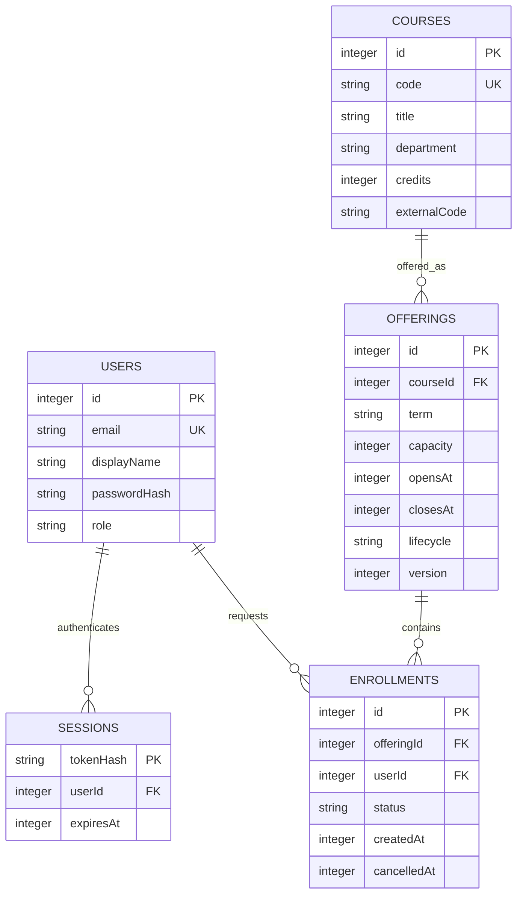

# M1 schema and integrity contract

Implemented in M2 in server/src/db/migrations.js and database.js. The original M1 spike retains separate probe tables; application integrity is independently tested in server/tests/database.test.js and concurrency.test.js.

- Required fields are non-null except optional externalCode/cancelledAt. Timestamps are UTC epoch milliseconds internally and ISO8601 in HTTP representations.
- users.email is normalized and unique; role CHECK(student,admin). Password hashes, session tokens and private roster records never enter catalog representations.
- courses.code unique; credits>0. Referenced courses are archived instead of physically deleted.
- offerings.capacity integer>=0; opensAt<closesAt; lifecycle DRAFT/PUBLISHED/ARCHIVED; version implements stale-admin-edit rejection. Foreign keys prevent orphaned offerings.
- enrollments have immutable offeringId/userId, a monotonic attempt id and CHECK(ACTIVE,WAITLISTED,CANCELLED). Partial UNIQUE(userId,offeringId) for ACTIVE/WAITLISTED allows cancelled history without duplicate current memberships.
- Migration2 also enforces one current ACTIVE/WAITLISTED request per user/course across all offerings. Service checks return409 course_already_requested; INSERT/UPDATE triggers guard raw writes. Cancelled history permits a later request. Startup refuses legacy cross-offering duplicates without deleting records, and offerings with history cannot change their course identity. This closes the literal course-level rule in the source specification, beyond the original per-offering index.
- Capacity guards cover INSERT/UPDATE into ACTIVE and admin capacity decrease; the indexed count of ACTIVE cannot exceed capacity. Every mutation uses the same consistency boundary, including cancellation/FIFO promotion.
- Query indexes initially include current-membership uniqueness and offering/status/id access. Candidate performance indexes remain hypotheses until SCL profiling; never remove integrity indexes for an apparent gain.

Migrations are ordered: users/sessions → courses/offerings → enrollments → guards/indexes. FK policy preserves enrollment history. Automated raw-SQL INSERT/UPDATE/FK/uniqueness checks are required in M2; only probe-table capacity/FK checks have run in M1.
